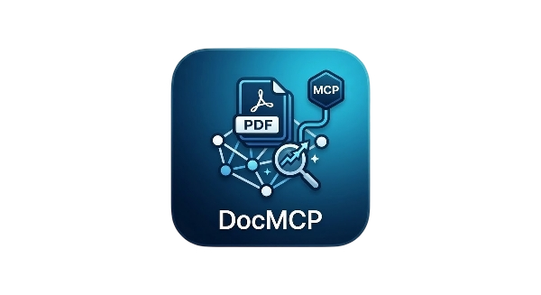

# DocMCP — PDF Vector Search + MCP Server

<p align="center">
  
</p>

Ingest PDF folders into a local **ChromaDB** vector database and expose them to **Kiro IDE** (or any MCP client) as semantic search tools. Includes a web UI for ingestion, search, and collection management.

**Highlights**

- **Model Context Protocol (MCP) server** in two implementations: JavaScript (`src/`) and Python (`src2/`)
- **Fully local**: embeddings run on your machine (ONNX / sentence-transformers), and the LLM runs on Ollama or llama.cpp
- **Recursive Language Model (RLM) reasoning** (`rlm_reason`): instead of answering only from the top-k search hits, a local LLM gets the **full documents** in a Python REPL, writes code to explore them, and calls sub-LLMs on the parts it needs. It uses the official [RLM library](https://github.com/alexzhang13/rlm).
- **Web UI** for ingesting PDFs (with a live progress log), semantic search, and collection management
- **One-command Docker setup**: ChromaDB, the web UI and the RLM/MCP server

---

## Docker Quick Start

Requires **Docker** and **[Ollama](https://ollama.com)** running on the host.

```powershell
# 1. Pull a model and give it a 16k context window (the RLM system prompt does not fit in Ollama's default)
ollama pull qwen3:4b
"FROM qwen3:4b`nPARAMETER num_ctx 16384" | Out-File -Encoding ascii Modelfile
ollama create qwen3:4b-16k -f Modelfile

# 2. Start ChromaDB + the web UI
docker compose up -d --build
```

1. Put your PDFs in `./pdfs`.
2. Open **http://localhost:3131** → Ingest, enter `/pdfs` as the folder, and click Start.
3. Ask a question with RLM (prints the REPL trajectory):

```powershell
docker compose run --rm -e RLM_VERBOSE=1 rlm python example_rlm_standalone.py "your question" some-file.pdf
```

To use another Ollama model, set `LLM_MODEL=<model>` before running the commands.

**Use the MCP server from your IDE.** Point the client at the container, which talks MCP over stdio:

```json
{
  "mcpServers": {
    "pdf-context": {
      "command": "docker",
      "args": ["compose", "-f", "C:\\absolute\\path\\to\\DMCP2\\docker-compose.yml", "run", "--rm", "-i", "rlm"]
    }
  }
}
```

> In Docker, the UI (Node) and the Python server both use `paraphrase-multilingual-MiniLM-L12-v2`, so they can share one collection: the UI uses the ONNX build of the model, and Python uses the sentence-transformers build.

---

## Project Structure

```
DMCP2/
├── src/                   JavaScript implementation
│   ├── embedder.js        Embedding model (env-driven, local ONNX)
│   ├── ingest.js          PDF ingestion CLI
│   └── index.js           MCP server (stdio → Kiro)
├── src2/                  Python implementation (same tools + real RLM)
│   ├── embedder.py        Embedding with sentence-transformers
│   ├── ingest.py          PDF ingestion CLI
│   ├── server.py          MCP server (rlm_reason uses the RLM library)
│   ├── example_rlm_standalone.py  Run rlm_reason from the command line
│   ├── requirements.txt   Python dependencies
│   └── README.md          Python-specific docs
├── resources/             Early RLM prototypes (reference only)
├── ui/
│   ├── index.html         Home page
│   ├── ingest.html        Ingest page
│   ├── search.html        Search page
│   ├── style.css          Shared styles
│   └── app.js             All client-side logic
├── ui-server.js           Static file server + API routes
├── delete-collection.js   CLI collection management
├── debug-upsert.js        Debug tool for ChromaDB issues
├── Dockerfile             One image: web UI (Node) + RLM/MCP server (Python)
├── docker-compose.yml     ChromaDB + UI + rlm services
├── .env                   Your config (copy from .env.example)
├── .env.example           Config template
└── package.json
```

---

## Manual Setup (without Docker)

Choose either the **JavaScript** (src/) or **Python** (src2/) implementation. Both provide the same search tools, but only the Python version runs real RLM reasoning (see [RLM Reasoning](#rlm-reasoning-rlm_reason)).

### 1. Prerequisites

**For JavaScript version:**
- **Node.js** 18+
- **Docker** (for ChromaDB)

**For Python version:**
- **Python** 3.11+ (required by the RLM library)
- **Docker** (for ChromaDB)
- See `src2/README.md` for Python-specific setup

### 2. Install

```powershell
npm install
```

### 3. Configure

Copy `.env.example` to `.env` and fill in your values:

```env
# ChromaDB
CHROMA_URL=http://localhost:9000
CHROMA_COLLECTION=pdf_context

# Embedding model (ONNX, runs fully local)
EMBEDDING_MODEL=onnx-community/embeddinggemma-300m-ONNX
EMBEDDING_DEVICE=auto
EMBEDDING_DTYPE=fp32

# HuggingFace token (only needed for gated models)
HF_TOKEN=

# Chunking
CHUNK_SIZE=800
CHUNK_OVERLAP=150

# Web UI
UI_PORT=3131
```

> **Important:** Use `fp32` for `EMBEDDING_DTYPE` on CPU. `fp16` produces NaN values on most CPUs and will cause ingestion to fail silently.

### 4. Start ChromaDB

```powershell
docker compose up -d
```

ChromaDB runs at `http://localhost:9000`. Data is persisted to a local Docker volume.

### 5. Start the Web UI

```powershell
npm run ui
```

Browser opens automatically at `http://localhost:3131`.

### 6. Ingest PDFs

**Via Web UI:** Go to `/ingest`, enter your PDF folder path, select or create a collection, click Start.

**Via CLI:**

```powershell
node src/ingest.js "C:\path\to\pdfs" --collection my-docs
```

Use `--reset` to wipe and recreate the collection before ingesting:

```powershell
node src/ingest.js "C:\path\to\pdfs" --collection my-docs --reset
```

---

## Connect to Kiro IDE

Open `.kiro/settings/mcp.json` and add:

**JavaScript version:**
```json
{
  "mcpServers": {
    "pdf-context": {
      "command": "node",
      "args": ["C:\\absolute\\path\\to\\DMCP2\\src\\index.js"],
      "env": {
        "CHROMA_URL": "http://localhost:9000",
        "CHROMA_COLLECTION": "ECDocs"
      }
    }
  }
}
```

**Python version:**
```json
{
  "mcpServers": {
    "pdf-context-python": {
      "command": "python",
      "args": ["C:\\absolute\\path\\to\\DMCP2\\src2\\server.py"],
      "env": {
        "CHROMA_URL": "http://localhost:9000",
        "CHROMA_COLLECTION": "ECDocs"
      }
    }
  }
}
```

Set `CHROMA_COLLECTION` to the collection you ingested into, then restart Kiro.

---

## MCP Tools

Both implementations provide these tools:

| Tool | Description |
|---|---|
| `search_pdf_context` | Semantic search across all ingested PDFs (returns top N results) |
| `search_pdf_context_by_score` | Semantic search that returns ALL results above a minimum score threshold |
| `list_pdf_sources` | List every PDF that has been ingested |
| `get_pdf_document` | Retrieve full text of a specific PDF |
| `delete_pdf_document` | Remove a PDF's chunks from the database |
| `list_collections` | List all ChromaDB collections |
| `rlm_reason` | Python: Recursive Language Model reasoning over the full PDF text. JS: an iterative retrieve → check → answer loop. Both need a local OpenAI-compatible LLM (Ollama / llama.cpp). |

### Example prompts in Kiro

```
Search the PDF context for the authentication flow
What does the architecture doc say about the database layer?
List all PDFs in the ECDocs collection

# Using the new score-based search:
Find all content about "API security" with similarity score above 0.8
Get comprehensive context about "database design" with minimum relevance of 0.75
```

### Score-Based Search Details

The new `search_pdf_context_by_score` tool is particularly useful when you need comprehensive context rather than just the top few results:

- **Regular search**: Returns exactly N top results (e.g., top 5 most relevant chunks)
- **Score-based search**: Returns ALL chunks that meet your relevance criteria (could be 2 results or 200+ results)

**Score ranges:**
- `0.9-1.0`: Extremely relevant, near-exact matches
- `0.8-0.9`: Highly relevant content
- `0.7-0.8`: Moderately relevant (good default threshold)
- `0.6-0.7`: Somewhat relevant
- `<0.6`: Low relevance (usually not useful)

---

## RLM Reasoning (`rlm_reason`)

Plain RAG embeds the question, takes the top-k chunks, and hopes the answer is in them. That fails on questions that need the whole document, such as "list every hyperparameter", "compare section 3 with section 5", or multi-hop questions.

The Python `rlm_reason` follows the [Recursive Language Models](https://github.com/alexzhang13/rlm) approach:

1. It loads the **full text** of every ingested PDF (or one PDF, via `source`) into a Python REPL as `context = {filename: text}`.
2. The root LLM sees **only the question** and metadata about the context, never the whole text.
3. The root LLM writes Python to search and slice `context`, and calls `llm_query(...)` on the pieces it needs (the recursive sub-calls).
4. It repeats until it sets a final answer, or until `max_iterations` (default 10) is reached.

| Env var | Default | Purpose |
|---|---|---|
| `LLAMACPP_URL` | `http://localhost:8080/v1` | Any OpenAI-compatible endpoint (Ollama: `http://localhost:11434/v1`) |
| `LLM_MODEL` | `qwen-8b` (Docker: `qwen3:4b-16k`) | Model name at that endpoint |
| `RLM_VERBOSE` | `0` | `1` prints the REPL trajectory (command-line use only, since it writes to stdout) |

**Trade-offs:** RLM is slower and makes more LLM calls than search, and the answer quality depends on how well the model writes REPL code. Small models (4B–8B) work for simple lookups; use a bigger model for heavier reasoning. The REPL runs model-written code in-process with restricted builtins, which is **not** a security sandbox, so only use it with documents you trust and a local model you control.

---

## Web UI

| Page | URL | Purpose |
|---|---|---|
| Home | `/` | Overview, config status |
| Ingest | `/ingest.html` | Index PDFs into a collection |
| Search | `/search.html` | Semantic search with result cards |

**Ingest page:**
- Shows existing collections with chunk counts — click to select
- Create a new collection by typing a name (min 3 chars) and clicking Use
- Live SSE log with color-coded tags: FILE / DONE / ERR / MODEL
- Progress bar per file
- Auto-refreshes collection list after completion
- Delete collections directly from the chip list

**Search page:**
- Collection dropdown auto-populated from ChromaDB
- Adjustable Top K (number input, no upper limit)
- Collapsible result cards showing match %, source filename, chunk index, and full text
- Delete collection button next to the dropdown

---

## Managing Collections

**Via Web UI:** Use the ✕ button on chips (ingest page) or the 🗑 button on the search page.

**Via CLI:**

```powershell
# List all collections with chunk counts
node delete-collection.js --list

# Delete with confirmation prompt
node delete-collection.js ECDocs

# Delete without prompt (for scripting)
node delete-collection.js ECDocs --force
```

---

## Embedding Model

The model is fully configurable via `.env`. It runs locally — no API key required for public models.

| Model | Size | Languages | Notes |
|---|---|---|---|
| `onnx-community/embeddinggemma-300m-ONNX` | ~300MB | 100+ | Best quality, recommended |
| `Xenova/paraphrase-multilingual-MiniLM-L12-v2` | ~120MB | 50+ | Lighter alternative |
| `Xenova/bge-m3` | ~570MB | 100+ | Best retrieval quality |
| `Xenova/all-MiniLM-L6-v2` | ~25MB | English only | Fastest |

First run downloads the model. Fully offline after that.

> **Switching models:** If you change `EMBEDDING_MODEL`, you must re-ingest all PDFs. Embeddings from different models are incompatible (different vector dimensions). Use `--reset` when re-ingesting.

---

## Troubleshooting

**ChromaDB unreachable**
```powershell
docker compose up -d
curl http://localhost:9000/api/v2/heartbeat
```

**422 Unprocessable Entity during ingest**
The collection has embeddings from a different model. Delete and re-ingest:
```powershell
node src/ingest.js "C:\path\to\pdfs" --collection my-docs --reset
```

**Embeddings are all NaN**
Set `EMBEDDING_DTYPE=fp32` in `.env`. `fp16` is not supported on most CPUs.

**"Collection not found" in Kiro**
`CHROMA_COLLECTION` in your Kiro MCP config must exactly match the collection name used during ingest (case-sensitive, min 3 chars, only `a-z A-Z 0-9 . _ -`).

**Kiro doesn't see the MCP tools**
- Verify the absolute path in your Kiro MCP config points to `src/index.js`
- Make sure `node` is in your PATH
- Restart Kiro after editing the config

**Debug ChromaDB upsert issues**
```powershell
node debug-upsert.js
```
This sends a test embedding directly to ChromaDB and prints the full error response.

---

## License

This project is licensed under the **GNU General Public License v3.0 (GPL-3.0)**.

You are free to use, study, modify, and distribute this code — including building on it or adding your own features — as long as:

- You keep the same GPL-3.0 license on any derivative work
- **Commercial use is not permitted**
- You give appropriate credit to the original project

See the full license text at: https://www.gnu.org/licenses/gpl-3.0.html

---

## About This Project

This project was primarily built with the assistance of **AI** (Claude by Anthropic), used as a development tool throughout the design, implementation, and debugging process.

That said, every line was **heavily monitored, reviewed, and tested by real developers** — the AI accelerated the work, but human judgment, domain knowledge, and hands-on testing shaped the final result. Nothing was shipped blindly.

If you build on this project, we encourage the same approach: use AI as a tool, not a substitute for understanding what your code actually does.
